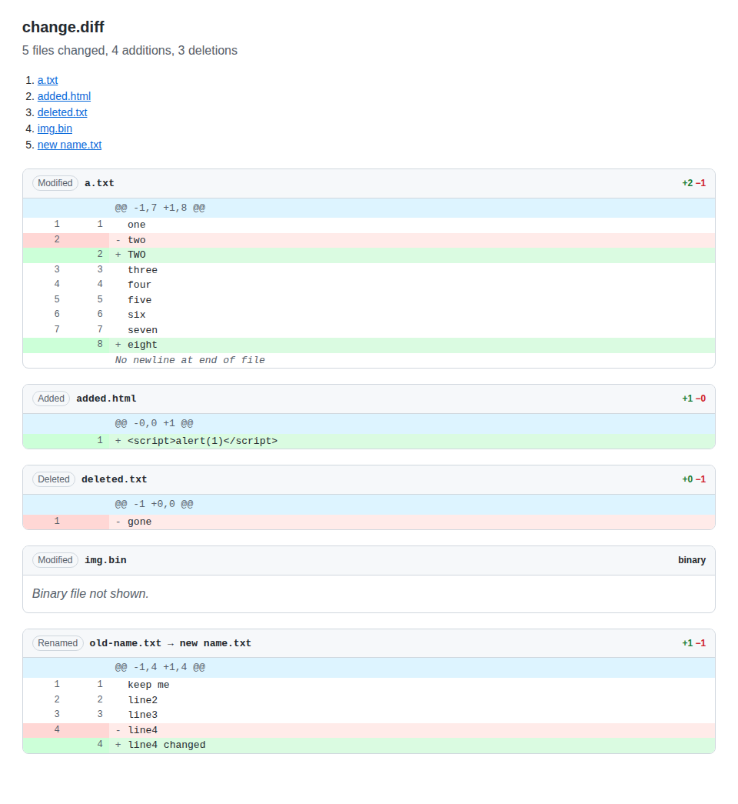
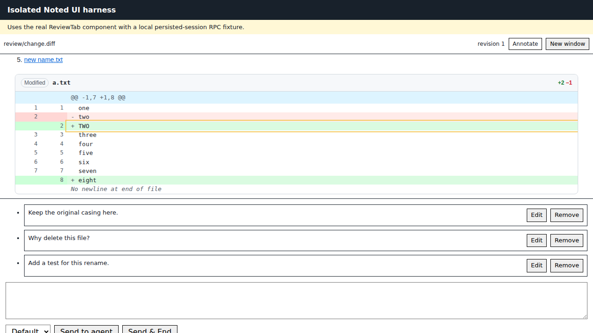
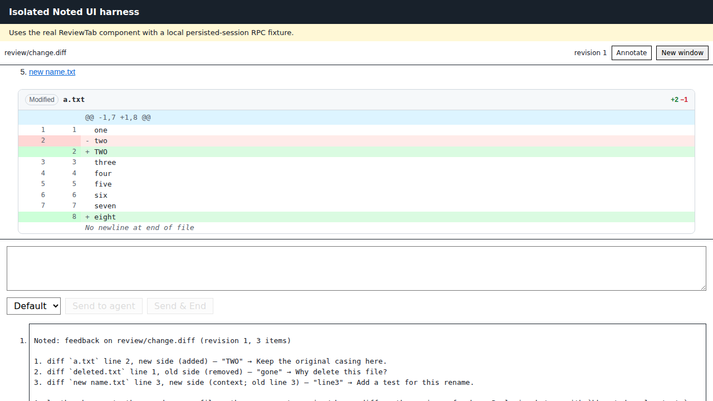

# MPI-2140: Diff and patch review

## User and job

An agent writes a unified diff, for example `git diff > "$BB_THREAD_STORAGE/review.diff"`, and opens it with `bb noted open`. The reviewer comments on specific diff lines, hunks, or files and sends the batch. The agent receives each item with the file path, side, and line number, edits the source files, and regenerates the diff.

## Acceptance criteria

1. A multi-file unified diff with additions, deletions, renames, and a binary notice opens in Noted with one annotatable element per hunk line. Each line row has a stable `id` and `data-kind`, `data-old-line`, and `data-new-line` attributes; each file section has `data-path`, `data-old-path`, `data-new-path`, and `data-status`.
2. Sent feedback for a diff item names the file path, side, and line, for example ``diff `a.txt` line 2, new side (added)``. Removed lines use the old path and old line number.
3. A changed diff file produces a new revision and a refreshed review, as other sources do.
4. Diff content is escaped and never rendered as HTML.
5. Typecheck, tests, and plugin builds pass. Tests cover the parser, renderer, selector mapping, and message formatting.

## Design

`lib/diff.ts` parses `git diff`, `git format-patch`, and `diff -u` output without a new dependency. It follows hunk line counts, so commit messages and email signatures in a patch are not read as diff lines. A format-patch commit message renders above its files.

Lavish identifies a target by the nearest ancestor `id`. A row's id encodes the file index, the hex-encoded path, and the line, such as `nd-0-612e747874-R2`. `lib/message.ts` decodes the id when the reviewed file is a `.diff` or `.patch`, so feedback stays correct even if the diff file changes before the batch is sent. Line numbers and +/- markers are CSS-generated, so the quoted excerpt is the code alone.

## Release and removal

Diff review is read-only and has no setting. `.diff` and `.patch` join the Noted file opener, which shows BB's preview with a **Review with Noted** button until review starts. To remove the feature, drop those extensions and the `isDiffPath` branch in `sourceDocumentHtml`; existing sessions keep their stored revisions and feedback.

## Evidence

`node e2e/isolated-ui-evidence.mjs` renders the fixture through the server's source pipeline, annotates three lines with the real Lavish SDK, and fails unless the sent message names each path, side, and line.

